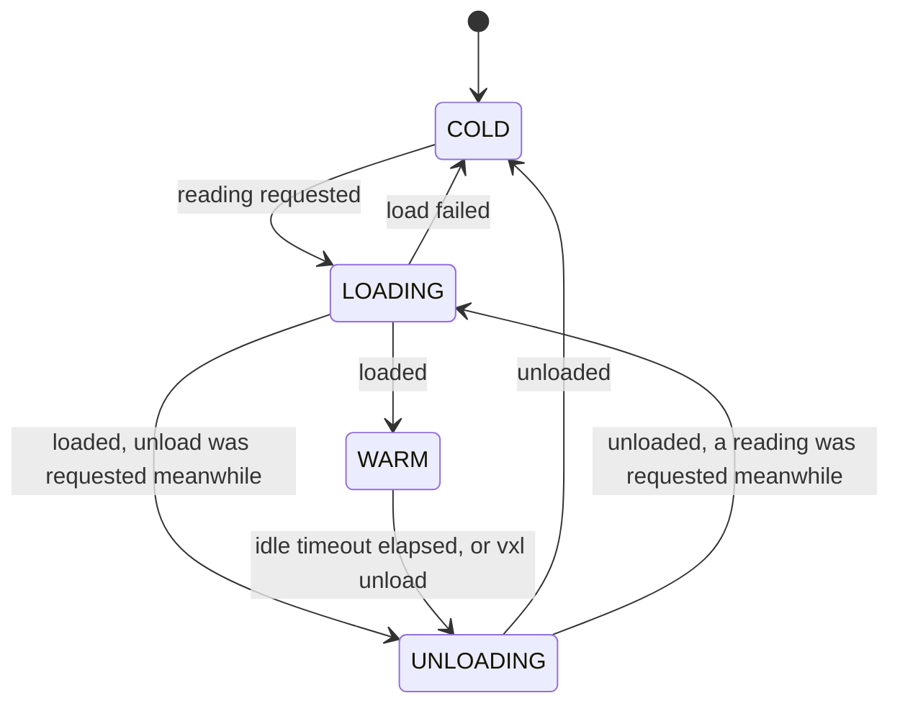

# voxlektor

Local text-to-speech for Apple Silicon Macs. A warm background daemon keeps the speech model
loaded and plays text aloud; the `voxlektor` / `vxl` command is a thin, fast client that talks
to it over a Unix socket. Nothing leaves your computer: the network is used only to download
the model.

```bash
vxl "Hello world."
pbpaste | vxl
vxl -f notes.txt
```

## Requirements

macOS 14+ on Apple Silicon, 8 GB RAM (16 GB recommended), ~4 GB disk. Other platforms: not yet.

## Install

Needs [uv](https://docs.astral.sh/uv/). From a checkout of this repository:

```bash
uv tool install --editable .
```

This puts `vxl` and `voxlektor` into `~/.local/bin` (make sure it is on your `PATH`). Undo with
`uv tool uninstall voxlektor`. The first reading downloads the model and starts the
daemon by itself; later readings reuse it.

## Commands

`vxl TEXT...` reads the text; any first word that is not a command name is text. To read a word
that is a command name or starts with `-`, use `vxl -- pause` or `vxl say pause`. With no
arguments `vxl` reads stdin when it is piped, otherwise it prints the help.

| Command | What it does |
|---|---|
| `vxl [say] [TEXT...]` | Read text aloud. Appends to the queue; returns at once. |
| `--voice`, `-v NAME` | Voice for this reading. |
| `--lang`, `-l auto\|pl\|en` | Language for this reading. |
| `--rate`, `-r 0.5..3.0` | Playback rate for this reading. |
| `--now` | Replace the current reading instead of queueing. |
| `-f FILE` | Read the text from FILE (not together with TEXT). |
| `vxl pause` / `resume` | Pause and resume the reading. |
| `vxl skip` / `back` | Next chunk / previous chunk. |
| `vxl stop-reading` | Stop the reading; the engine stays warm. |
| `vxl status` | State, engine, voice, idle timer, last reading metrics; `OFF` when no daemon runs. |
| `vxl idle DUR` | Set the idle timeout live: `0` (never unload), `90s`, `10m`, `1h`. |
| `vxl unload` | Free the model from RAM now; the daemon keeps running. |
| `vxl stop` | Stop the daemon (`not running` and exit 0 when none runs). |
| `vxl serve [--idle DUR]` | Run the daemon in the foreground (normally autostarted). |
| `vxl voices` | List voices; `*` marks the default. |
| `vxl config voice NAME` | Set the default voice. |
| `vxl config show` | Show the effective settings in the `config.toml` layout. |

Exit codes: `0` ok, `1` user error (bad input or option, unknown voice, invalid duration),
`2` service unavailable (daemon failed or does not answer, engine or audio failure),
`3` unsupported platform, `130` interrupted with Ctrl+C.

Bundled voices: `v0-default`, `f1-warm`, `f2-narrator`, `f3-bright`, `m1-calm`, `m2-narrator`,
`m3-casual`.

## Configuration

Precedence: command-line flag > environment variable > `config.toml` > default. The file lives
in `~/.config/voxlektor/config.toml`; `vxl config voice NAME` writes it, and `vxl config show`
prints what is in effect.

```toml
config_version = 1
engine = "omnivoice"
voice = "v0-default"
lang = "auto"       # auto, pl or en
base_lang = "pl"    # pl or en; see "Language detection"
rate = 1.0          # 0.5 to 3.0
history = 20        # chunks kept for `vxl back`

[service]
idle_timeout = "10m"   # 0, 90s, 10m, 1h; 0 = never unload
autostart = true       # false = read in the calling process, without a daemon
```

| `config.toml` key | Environment variable | Default |
|---|---|---|
| `engine` | `VOXLEKTOR_ENGINE` | `omnivoice` |
| `voice` | `VOXLEKTOR_VOICE` | `v0-default` |
| `lang` | `VOXLEKTOR_LANG` | `auto` |
| `base_lang` | `VOXLEKTOR_BASE_LANG` | `pl` |
| `rate` | `VOXLEKTOR_RATE` | `1.0` |
| `service.idle_timeout` | `VOXLEKTOR_IDLE_TIMEOUT` | `10m` |
| `service.autostart` | `VOXLEKTOR_AUTOSTART` | `true` |
| `history` | none | `20` |
| none | `VOXLEKTOR_HOME` | unset: config in `~/.config/voxlektor`, runtime files in `~/Library/Application Support/voxlektor`. Set to a directory to keep both under `<dir>/config` and `<dir>/run` instead. |
| none | `VOXLEKTOR_OUTPUT` | Test-only: `memory` plays nothing and records instead. Never needed for normal use. |

## Language detection

With `lang = "auto"` every paragraph is classified as Polish or English on its own. Polish
diacritics decide at once; otherwise the Polish and English marker words are counted. Text that
cannot be decided (a tie, such as `npm run dev` or `to do`) is read in `base_lang`. Set
`base_lang = "en"` if you mostly read English; force a language with `--lang`.

## Cues

Two short sounds tell you what happened without a screen. They play next to the reading, also
while it is paused. A soft tone means a failed generation is being retried. A spoken message
("Reading stopped because of an error. Run vxl status for details.") means the reading was
stopped by an error.

## Keep-warm lifecycle

The model is loaded on demand and unloaded after it has been idle for `idle_timeout`; the daemon
itself stays (about 50 MB). At most one engine is in RAM.



The idle timer starts when the reading ends and is cancelled when a new one begins.
`idle_timeout = 0` never unloads. `vxl stop` ends the daemon from any state.

## Measured performance

`uv run python scripts/bench_gaps.py` reads the same three-paragraph text with the real model
(playback simulated in real time, nothing is played aloud) and reports, per voice, rate and
language, the time to first audio, gaps between chunks (underruns) and generation time divided
by audio time (below 1.0 is faster than real time).

Measured 2026-11-12 on a Mac M4, 32 GB, OmniVoice `mlx-community/OmniVoice-bf16` at revision
`8fb0b754cad788aaefec690cd55c207e8a628f85`, 16 steps, model already warm. Model load plus the
first reading took 29.5 s; the whole run took 525 s.

| voice | rate | lang | first_audio_s | underruns | gen/audio ratio |
|---|---|---|---|---|---|
| v0-default | 1 | pl | 4.87 | 0 | 0.63 |
| v0-default | 1 | en | 4.33 | 0 | 0.63 |
| v0-default | 1.25 | pl | 4.76 | 0 | 0.80 |
| v0-default | 1.25 | en | 4.36 | 0 | 0.79 |
| v0-default | 1.5 | pl | 4.68 | 0 | 0.95 |
| v0-default | 1.5 | en | 4.41 | 1 | 0.98 |
| f2-narrator | 1 | pl | 4.52 | 0 | 0.60 |
| f2-narrator | 1 | en | 10.53 | 1 | 1.52 |
| f2-narrator | 1.25 | pl | 4.55 | 0 | 0.77 |
| f2-narrator | 1.25 | en | 4.00 | 0 | 0.73 |
| f2-narrator | 1.5 | pl | 4.36 | 0 | 0.89 |
| f2-narrator | 1.5 | en | 3.92 | 0 | 0.88 |
| m1-calm | 1 | pl | 5.29 | 0 | 0.67 |
| m1-calm | 1 | en | 11.14 | 1 | 1.52 |
| m1-calm | 1.25 | pl | 4.79 | 0 | 0.78 |
| m1-calm | 1.25 | en | 4.27 | 0 | 0.76 |
| m1-calm | 1.5 | pl | 4.69 | 0 | 0.91 |
| m1-calm | 1.5 | en | 4.19 | 0 | 0.92 |

Reading it: generation stays ahead of playback up to rate 1.25 (ratio 0.6 to 0.8); at 1.5 it is
close to the limit (0.9 to 1.0) and one gap appeared. Two rows (`f2-narrator` and `m1-calm`,
English at rate 1) are outliers with a first audio above 10 s, a ratio of 1.5 and one underrun
each; their cause is unknown and still to be investigated (`v0-default` English at rate 1 is
not affected). In total the run had 3 underruns: one at rate 1.5 and two in the outlier rows.
Time to first audio is about 4 to 5 s here, above the 3 s goal; the first chunk is a whole
paragraph, which is the likely cause.

## More

- [Architecture](docs/architecture.md): layers, module map, threads.
- [Socket protocol v1](docs/protocol.md): commands, `status` fields, errors.
