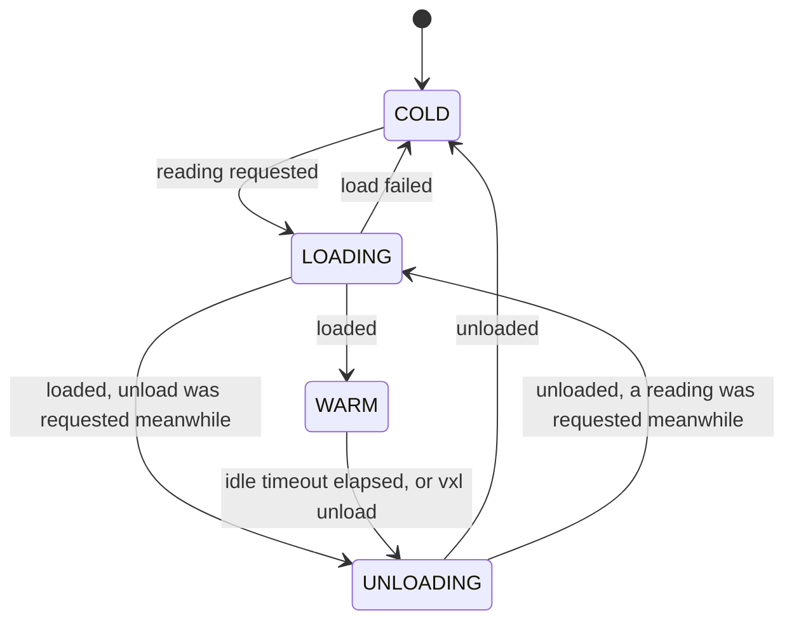

# voxlektor

Local text-to-speech for Apple Silicon Macs. A warm background daemon keeps the speech model
loaded and plays text aloud; the `voxlektor` / `vxl` command is a thin, fast client that talks
to it over a Unix socket. Nothing leaves your computer: the network is used only to download
the model.

```bash
vxl "Hello world."
pbpaste | vxl
vxl -f notes.txt
```

## Requirements

macOS 14+ on Apple Silicon, 8 GB RAM (16 GB recommended), ~4 GB disk. Other platforms: not yet.

## Install

Needs [uv](https://docs.astral.sh/uv/). Straight from GitHub:

```bash
uv tool install git+https://github.com/MlecznyU/voxlektor
```

or from a checkout of this repository:

```bash
uv tool install --editable .
```

This puts `vxl` and `voxlektor` into `~/.local/bin` (make sure it is on your `PATH`). Undo with
`uv tool uninstall voxlektor`. Then run the setup once (it is required before the first
reading, and you can run it again at any time):

```bash
vxl setup
```

It walks you through the engine, the model download (about 1.7 GB; it shows the model license
and asks you to accept it), the voice, base language, rate and volume (with samples) and the
service settings; Enter keeps the shown value. Tools without a terminal use the flag mode:
`vxl setup --yes [--voice V --volume N ... --accept-model-license]`. At the end, setup stops
a running daemon so the next start uses the new settings (the flag mode only when something
changed). An invalid value in `config.toml` or a `VOXLEKTOR_*` variable does not stop setup: it
says which value it ignores and writes a valid one. After that, the first reading starts the
daemon by itself (with `autostart = true`); later readings reuse it.

## Commands

`vxl TEXT...` reads the text; any first word that is not a command name is text. To read a word
that is a command name or starts with `-`, use `vxl -- pause` or `vxl say pause`. With no
arguments `vxl` reads stdin when it is piped, otherwise it prints the help.

| Command | What it does |
|---|---|
| `vxl [say] [TEXT...]` | Read text aloud. Appends to the queue; returns at once. |
| `--voice`, `-v NAME` | Voice for this reading. |
| `--lang`, `-l auto\|pl\|en` | Language for this reading. |
| `--rate`, `-r 0.5..3.0` | Speaking rate for this reading. From 0.75 to 1.5 the model itself speaks at that pace; outside that band the audio is time-stretched. |
| `--volume 0..100` | Volume for this reading; 50 = the even, normalised level. |
| `--steps 4..32` | Diffusion steps for this reading; fewer = faster, more = finer (default 12; 8 steps take about half the time of 16). |
| `--profile NAME` | Read with that settings profile (flags still win; `VOXLEKTOR_*` only for keys the profile does not set; an unknown profile is exit 1). |
| `--now` | Replace the current reading instead of queueing (only readings of the same owner). |
| `-f FILE` | Read the text from FILE (not together with TEXT). |
| `--owner X`, `--group G` | Read as owner X (a client name; `cli`, the plain CLI's own, is reserved) in group G (read without interruption). See [Many clients](#many-clients-at-once). |
| `--tag T` | Label this text; `vxl watch` reports when it starts and finishes. |
| `--preempt` | Take the floor from another owner at once (its reading resumes afterwards). |
| `--json` | One JSON line: the reply (`chunks`, `group`), plus `"daemon_outdated": true` when an older daemon had to be kept. |
| `vxl pause` / `resume` | Pause and resume the reading. |
| `vxl skip` / `back` | Next chunk / previous chunk. |
| `--unit tag` | On `skip` / `back` (0.4.0, feature `tag_nav`): move by a whole tag (a paragraph sent with `--tag`). `skip` goes to the next tag, `back` restarts the current one, or goes to the previous one if the current one has not got past its first chunk; audio generated ahead is kept. See [Tag navigation](docs/protocol.md#tag-navigation). |
| `vxl stop-reading` | Stop the reading; the engine stays warm. |
| `--owner X` | On `pause`, `resume`, `skip`, `back`, `stop-reading`: act on owner X's readings only. |
| `vxl status` | State, engine, voice, idle timer, last reading metrics; `OFF` when no daemon runs. |
| `--json` | One JSON line for tools: `{"running": false}`, or `{"running": true, ...}` with the [protocol `status` fields](docs/protocol.md#status) (`state`, `engine`, `voice`, `queued`, `playing`, `paused`, `underruns`, `first_audio_s`, `chunks`, `gen_seconds`, `audio_seconds`, `last_error`, `caps`, `floor`, `waiting`, `groups`, `tag`, `version`, ...). A daemon that holds the lock but does not answer: `{"running": true, "answering": false, "pid": N}` (`pid` is `null` when it cannot be told). `running` means a daemon process is there, not that it answers. Every line also has `"protocol": 1`, the protocol version; tools gate on it (absent means 1). |
| `vxl idle DUR` | Set the idle timeout live: `0` (never unload), `90s`, `10m`, `1h`. |
| `vxl unload` | Free the model from RAM now; the daemon keeps running. |
| `vxl stop` | Stop the daemon (`not running` and exit 0 when none runs). A hung daemon (it holds the lock but does not answer; `vxl say`, `warm` and `watch --start` then fail with exit 2 and its pid once it has neither answered nor released the lock for 15 s, so a cold start or an ordinary stop never counts; `vxl status` gives it 2 s) gets 5 s to answer, then SIGTERM, then SIGKILL after 3 s; `stop` prints what it did (a process that is not verifiably a voxlektor daemon is never signalled: exit 2 with its pid). |
| `vxl serve [--idle DUR]` | Run the daemon in the foreground (normally autostarted). |
| `vxl warm [--profile NAME]` | Start the daemon if needed and load the model now, so the next reading starts quickly; returns at once (the usual idle timeout follows). |
| `vxl watch` | Print the daemon's events as they happen, one line each, until it goes away (exit 2; Ctrl+C or SIGTERM: exit 0). Waits for a daemon that is not running. |
| `--json` | One JSON object per line: the event's data plus `"event"`; the first is `snapshot` (the status, plus `"protocol": 1`). |
| `--owner X` | Only X's events, every `floor`, `state`, and daemon-wide `drained`/`error`/`paused`/`resumed`. |
| `--start` | Start the daemon first when it is not running. The line protocol is in [docs/protocol.md](docs/protocol.md#vxl-watch). |
| `vxl voices` | List voices; `*` marks the default. |
| `--json` | One JSON line for tools: `{"default": NAME, "voices": [...]}`. |
| `vxl config voice NAME` | Set the default voice. |
| `vxl config show [--profile NAME]` | Show the effective settings (of that profile) in the `config.toml` layout. |
| `vxl profiles` | List the settings profiles with each value's effective setting and source (`env`, `profile`, `default`, `builtin`). |
| `--json` | One JSON line for tools: `{"profiles": [{"name", "values", "sources"}]}`, `default` first. |
| `vxl profiles rm NAME` | Remove a profile (`default` cannot be removed). |
| `vxl setup` | Guided setup with menus and samples (required once before reading; re-runnable). |
| `--yes` | No questions, no samples, no daemon start: given options, current values for the rest. |
| `--engine E`, `--voice V`, `--base-lang pl\|en` | Values for `--yes`. |
| `--rate R`, `--volume N`, `--idle DUR`, `--autostart/--no-autostart` | Values for `--yes`. |
| `--profile NAME` | Set up one settings profile (see "Profiles"). With `--yes` only the given profile options are stored; without it, a short guided run for that profile (needs a completed setup). |
| `--lang L`, `--steps N` | Profile values; only with `--profile`. |
| `--progress text\|json` | With `--yes`: `json` prints model-download progress as JSON lines on stdout (see docs/protocol.md). A usage error (bad or conflicting options) prints no JSON line at all, only the message on stderr: the exit code is authoritative. |
| `--accept-model-license` | Needed with `--yes` when the model still has to be downloaded. |
| `--check` | Change nothing; print one JSON line (`ready`, `setup_completed`, `version`, `protocol`, `engine`, `model` with `present` and its license, effective `settings` incl. `steps`, `features`: what this version offers, e.g. `["owners", "profiles", "steps", "tag_nav", "tags", "warm", "watch"]`; with `--profile NAME` also `profile` and `profile_exists`, and `settings` are that profile's); exit `0` when ready, `1` if not. |

### Many clients at once

Several clients (for example dialogue-box in several Claude Code sessions, plus you at the
keyboard) share one daemon. Each names itself with `--owner`; readings queue in groups, and the
floor passes only at a group boundary to the oldest waiting group, so nobody cuts anybody off.
`--now`, `pause`, `skip`, `back` and `stop-reading` with `--owner` touch only that owner's
readings; without `--owner` they act on whatever is speaking (and `vxl pause` holds the whole
daemon until `vxl resume`). A paused owner keeps the floor for `floor_grace` (8 s) once someone
else waits. Details: [docs/protocol.md](docs/protocol.md#owners-groups-and-the-floor).

After `uv tool upgrade voxlektor` (or pulling a checkout), the next `vxl say`, `vxl warm` or
`vxl watch` replaces an older daemon when it is idle; when it is reading, the old one is kept
until `vxl stop`. If you pulled changes to `pyproject.toml` entry points (new engines, new
commands), reinstall: `uv tool install --editable . --reinstall`.

Until `vxl setup` has completed, reading exits `1` with `voxlektor is not set up yet; run: vxl
setup`; control commands keep working.

Exit codes: `0` ok, `1` user error (bad input or option, unknown voice, invalid duration),
`2` service unavailable (daemon failed or does not answer, engine or audio failure),
`3` unsupported platform, `130` interrupted with Ctrl+C.

Bundled voices: `v0-default`, `f1-warm`, `f2-narrator`, `f3-bright`, `m1-calm`, `m2-narrator`,
`m3-casual`, `zoe-spark` (cheerful, quick).

## Configuration

Precedence: command-line flag > the selected profile's own keys > environment variable > `default` profile (or the top-level keys of an older file) > built-in default. A `VOXLEKTOR_*` variable overrides `default` (and so every key a profile inherits from it), never a key that the selected profile sets itself. The file lives
in `~/.config/voxlektor/config.toml`; `vxl config voice NAME` writes it, and `vxl config show`
prints what is in effect. `voice`, `lang`, `base_lang`, `rate`, `volume` and `steps` (the profile keys) travel with every request, so a
change applies to the next reading of a running daemon. `engine`, `history` and
`service.idle_timeout` and `service.floor_grace` are read when the daemon starts (`vxl idle` changes the timeout live).

```toml
config_version = 2
engine = "omnivoice"
history = 20        # chunks kept for `vxl back`

[service]
idle_timeout = "10m"   # 0, 90s, 10m, 1h; 0 = never unload
autostart = true       # false = read in the calling process, without a daemon
floor_grace = "8s"     # how long a paused owner keeps the floor while another waits; 0 = at once

[profiles.default]
voice = "v0-default"
lang = "auto"       # auto, pl or en
base_lang = "pl"    # pl or en; see "Language detection"
rate = 1.0          # 0.5 to 3.0; 0.75 to 1.5 spoken by the model itself
volume = 50         # 0 to 100; 50 = even level
steps = 12          # 4 to 32 diffusion steps; fewer = faster

[profiles.claude]   # only what differs from default
rate = 1.1
steps = 8
```

A `config.toml` from 0.2.0 (`config_version = 1`, the profile keys at the top level) still reads
as is: those keys are the `default` profile. The first save (`vxl config`, `vxl setup`) rewrites
it as version 2; reading never does.

Downgrading after 0.3.0 has written a version 2 file: an older CLI (0.2.x) does not know
`[profiles]` and writes `vxl config` values at the top level again. 0.3.0 then warns about the
mixed file, uses those top-level values only where `[profiles.default]` lacks the key, and moves
them into `[profiles.default]` on its next save (a top-level value that `[profiles.default]`
already overrides is dropped then, with a warning that names both values).

### Profiles

A **profile** is a named overlay of the per-reading settings `voice`, `lang`, `base_lang`, `rate`,
`volume` and `steps`. It stores only the keys it sets; every other key comes from `default`
(which always exists, implicitly), then from the built-in defaults. Resolution order, per key:

**flag > selected profile's own keys > `VOXLEKTOR_*` > `default` profile > built-in default**

So an environment variable overrides `default` (and every key a profile inherits from it), but
never a key that the selected profile sets itself.

`engine`, `history`, `service.idle_timeout`, `service.autostart` and `service.floor_grace` are
**global**: they are not per profile and cannot be set in a profile. Profile names are `a-z`,
`0-9`, `-` and `_`, up to 32 characters, starting with a letter or digit.

| Command | What it does |
|---|---|
| `vxl say --profile NAME ...` | Read with that profile; flags still win, `VOXLEKTOR_*` variables only for keys the profile does not set. Unknown or invalid name: exit 1, nothing sent. Also `vxl warm --profile NAME` and `vxl config show --profile NAME` (the profile's effective settings). |
| `vxl setup --profile NAME` | Interactive run for a non-default profile: voice, base language, rate, volume, reading language (`lang`) and quality steps, each showing its current value and source, with "same as default"; needs a completed setup and leaves a running daemon alone. `--profile default` is the full setup. |
| `vxl setup --yes --profile NAME [--voice V --lang L --base-lang B --rate R --volume N --steps N]` | Headless: creates the profile (also with no options) and stores only the options given, even if equal to `default`'s. Marks setup as completed, so it alone makes `--check --profile NAME` ready. Global options (`--engine`, `--idle`, `--autostart`) are refused with `--profile` (exit 1); `--lang` and `--steps` need `--profile`. |
| `vxl setup --check --profile NAME` | Readiness for that profile; `profile_exists: false` and exit 1 if it is missing. |
| `vxl profiles [--json]` | Every profile with each value and where it comes from (`env`, `profile`, `default`, `builtin`). An invalid value is reported on stderr and skipped (the next layer's value is shown); only a file that is no TOML exits 1. `vxl config show` and `vxl setup --check` treat invalid values the same way. |
| `vxl profiles rm NAME` | Remove a profile; `default` and unknown names are refused (exit 1). |

For a tool such as dialogue-box, one call prepares a profile with no terminal:

```bash
vxl setup --yes --profile claude --rate 1.1 --steps 8
vxl say --profile claude "Done."
```

Only the daemon-wide settings need a daemon restart; profiles never reach the daemon, because
the resolved values travel with every request. `vxl config voice NAME` still writes `default`.

| `config.toml` key | Environment variable | Default |
|---|---|---|
| `engine` | `VOXLEKTOR_ENGINE` | `omnivoice` |
| `voice` | `VOXLEKTOR_VOICE` | `v0-default` |
| `lang` | `VOXLEKTOR_LANG` | `auto` |
| `base_lang` | `VOXLEKTOR_BASE_LANG` | `pl` |
| `rate` | `VOXLEKTOR_RATE` | `1.0` |
| `volume` | `VOXLEKTOR_VOLUME` | `50` |
| `steps` | `VOXLEKTOR_STEPS` | `12` |
| `service.idle_timeout` | `VOXLEKTOR_IDLE_TIMEOUT` | `10m` |
| `service.autostart` | `VOXLEKTOR_AUTOSTART` | `true` |
| `service.floor_grace` | `VOXLEKTOR_FLOOR_GRACE` | `8s` |
| `history` | none | `20` |
| none | `VOXLEKTOR_HOME` | unset: config in `~/.config/voxlektor`, runtime files in `~/Library/Application Support/voxlektor`. Set to a directory to keep both under `<dir>/config` and `<dir>/run` instead. |
| none | `VOXLEKTOR_OUTPUT` | Test-only: `memory` plays nothing and records instead. Never needed for normal use. |

## Language detection

With `lang = "auto"` every paragraph is classified as Polish or English on its own. Polish
diacritics decide at once; otherwise the Polish and English marker words are counted. Text that
cannot be decided (a tie, such as `npm run dev` or `to do`) is read in `base_lang`. Set
`base_lang = "en"` if you mostly read English; force a language with `--lang`.

## Pauses, pace and quality

The silence the model leaves at the edges of every generated chunk is trimmed, and the chunks
play through one continuous audio stream with short fades, so the pauses you hear come from
the structure of the text, the same for a pasted chapter and for a client's paragraphs:

| Before the next chunk | Pause |
|---|---|
| a sentence ended (same paragraph) | 0.25 s |
| a paragraph of the text ended (blank line), or one `vxl say` ended and the next follows | 0.5 s |
| a group ended, or another client takes the floor | 0.8 s |
| the first chunk after silence | none |
| after `skip`, `back`, or a preemption | 0.25 s |

A pause is a minimum: when the next chunk is late, the wait counts toward it. Pauses the model
makes inside one chunk are its own prosody. The first two chunks of a reading that starts from
silence are kept short, so the first audio comes quickly.

Rate: from 0.75 to 1.5 the model itself speaks at the requested pace (natural, nothing
stretched); outside that band it speaks at 1.0 and the audio is time-stretched. `steps` (4 to
32, default 12) trades quality for speed: 8 steps generate about twice as fast as 16.

## Cues

Two short sounds tell you what happened without a screen. They play next to the reading, also
while it is paused. A soft tone means a failed generation is being retried. A spoken message
("Reading stopped because of an error. Run vxl status for details.") means the reading was
stopped by an error.

## Keep-warm lifecycle

The model is loaded on demand and unloaded after it has been idle for `idle_timeout`; the daemon
itself stays (about 50 MB). At most one engine is in RAM.



The idle timer starts when the reading ends and is cancelled when a new one begins.
`idle_timeout = 0` never unloads. `vxl stop` ends the daemon from any state.

## Measured performance

`uv run python scripts/bench_gaps.py` reads the same three-paragraph text with the real model
(playback simulated in real time, nothing is played aloud) and reports, per voice, rate and
language, the time to first audio, gaps between chunks (underruns) and generation time divided
by audio time (below 1.0 is faster than real time).

Measured 2026-11-12 on a Mac M4, 32 GB, OmniVoice `mlx-community/OmniVoice-bf16` at revision
`8fb0b754cad788aaefec690cd55c207e8a628f85`, 16 steps, model already warm. Model load plus the
first reading took 29.5 s; the whole run took 525 s.

| voice | rate | lang | first_audio_s | underruns | gen/audio ratio |
|---|---|---|---|---|---|
| v0-default | 1 | pl | 4.87 | 0 | 0.63 |
| v0-default | 1 | en | 4.33 | 0 | 0.63 |
| v0-default | 1.25 | pl | 4.76 | 0 | 0.80 |
| v0-default | 1.25 | en | 4.36 | 0 | 0.79 |
| v0-default | 1.5 | pl | 4.68 | 0 | 0.95 |
| v0-default | 1.5 | en | 4.41 | 1 | 0.98 |
| f2-narrator | 1 | pl | 4.52 | 0 | 0.60 |
| f2-narrator | 1 | en | 10.53 | 1 | 1.52 |
| f2-narrator | 1.25 | pl | 4.55 | 0 | 0.77 |
| f2-narrator | 1.25 | en | 4.00 | 0 | 0.73 |
| f2-narrator | 1.5 | pl | 4.36 | 0 | 0.89 |
| f2-narrator | 1.5 | en | 3.92 | 0 | 0.88 |
| m1-calm | 1 | pl | 5.29 | 0 | 0.67 |
| m1-calm | 1 | en | 11.14 | 1 | 1.52 |
| m1-calm | 1.25 | pl | 4.79 | 0 | 0.78 |
| m1-calm | 1.25 | en | 4.27 | 0 | 0.76 |
| m1-calm | 1.5 | pl | 4.69 | 0 | 0.91 |
| m1-calm | 1.5 | en | 4.19 | 0 | 0.92 |

Reading it: generation stays ahead of playback up to rate 1.25 (ratio 0.6 to 0.8); at 1.5 it is
close to the limit (0.9 to 1.0) and one gap appeared. Two rows (`f2-narrator` and `m1-calm`,
English at rate 1) are outliers with a first audio above 10 s, a ratio of 1.5 and one underrun
each; their cause is unknown and still to be investigated (`v0-default` English at rate 1 is
not affected). In total the run had 3 underruns: one at rate 1.5 and two in the outlier rows.
Time to first audio is about 4 to 5 s here, above the 3 s goal; the first chunk is a whole
paragraph, which is the likely cause (0.3.0 caps the first two chunks; see below).

### Latency (0.3.0)

`uv run python scripts/bench_latency.py [--steps 16 8] [--rate 1.0 1.1] [--voice NAME] [--json]`
runs the daemon's real pipeline (pause policy, start caps, native rate, trimming) on a
five-paragraph Polish reply with English terms (1220 characters), one `speak` per paragraph in
one group as dialogue-box sends it, playback simulated in real time. The first reading is cold
(model load included), then every steps x rate combination is read warm. It reports first
audio, total time, generation vs audio per chunk, stalls (silence beyond the pause asked for)
and the silence heard.

Measured 2026-11-16 on a Mac M4, 32 GB, voice `f3-bright` (before 0.3.0: first audio 3.0 s,
total 84.4 s, 11.7 s of silence, one 0.8 s stall at 16 steps, rate 1.0):

| steps | rate | first audio s | total s | gen / audio s | silence heard s (pauses + stalls + edges) |
|---|---|---|---|---|---|
| 16 (cold) | 1.0 | 5.80 | 83.3 | 36.8 / 74.9 | 4.6 (2.5 + 0.1 + 2.0) |
| 16 | 1.0 | 3.36 | 83.7 | 41.2 / 75.1 | 6.4 (2.5 + 2.8 + 1.1) |
| 16 | 1.1 | 3.27 | 78.5 | 40.5 / 69.7 | 6.9 (2.5 + 3.1 + 1.3) |
| 12 | 1.0 | 2.24 | 79.3 | 28.8 / 74.6 | 4.2 (2.5 + 0 + 1.7) |
| 8 | 1.0 | 1.71 | 78.3 | 22.0 / 74.1 | 3.5 (2.5 + 0 + 1.0) |
| 8 | 1.1 | 1.72 | 73.1 | 21.2 / 68.9 | 3.6 (2.5 + 0 + 1.1) |

Cold start: model load 2.0 s; the cold row above also built the voice prompt fresh (0.7 s), with
the prompt cached a cold first audio took 4.6 s (at 12 steps). At 16 steps
the first chunk of the second paragraph (274 characters, about 9 s to generate) arrives 2.5 to
3 s late, because the three short chunks of the first paragraph play for only about 13 s; at 12
and 8 steps nothing stalls.

## License & model terms

**voxlektor's code** is licensed under the [Apache License 2.0](LICENSE), Copyright 2026
MlecznyU. You may use, modify and redistribute it under that license.

**The speech model is not part of this repository** and is not covered by that license. It is
downloaded from Hugging Face on first use (or by `vxl setup`) and comes with its own terms:

- **OmniVoice weights** ([k2-fsa/OmniVoice](https://huggingface.co/k2-fsa/OmniVoice), used here
  as the MLX conversion `mlx-community/OmniVoice-bf16`) are licensed **CC-BY-NC**: research and
  other **non-commercial use only**, because of constraints from its training data (such as the
  Emilia dataset). OmniVoice's own code is Apache 2.0.
- The model's **audio tokenizer** is derived from Higgs Audio v2 and is subject to Boson AI's
  own license for it.
- The **8 bundled voices** (`src/voxlektor/bundled_voices`) are synthetic: each reference sample
  was designed from a text description with VoxCPM2 (Apache 2.0). They are not recordings of
  real people.
- Do not use voxlektor to clone or impersonate anyone's voice without their consent, or for
  fraud or deception. Check that your use complies with the model licenses and the law where you
  live; you are responsible for how you use it.

## Contributing

Issues and pull requests are welcome; see [CONTRIBUTING.md](CONTRIBUTING.md). Pull requests are
merged at the author's discretion.

## More

- [Architecture](docs/architecture.md): layers, module map, threads.
- [Socket protocol v1](docs/protocol.md): commands, `status` fields, errors.
