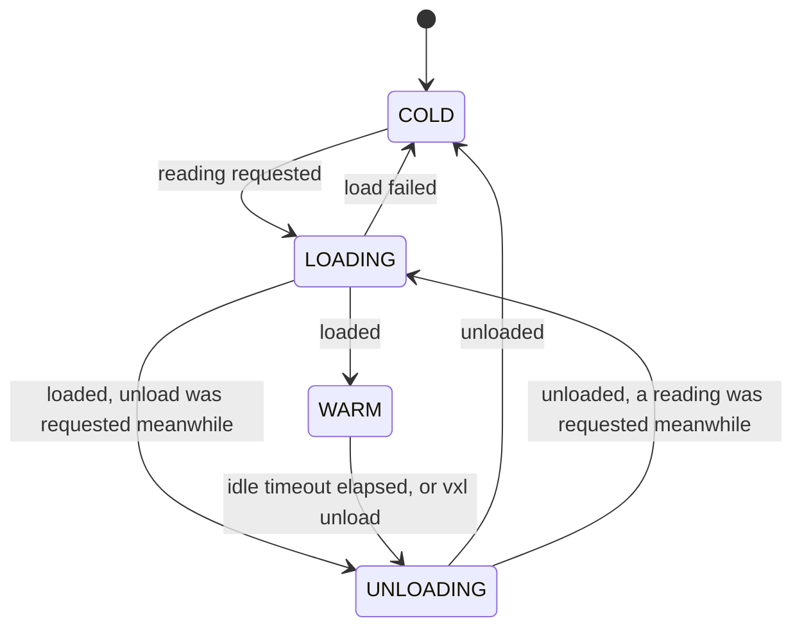

# voxlektor

Local text-to-speech for Apple Silicon Macs. A warm background daemon keeps the speech model
loaded and plays text aloud; the `voxlektor` / `vxl` command is a thin, fast client that talks
to it over a Unix socket. Nothing leaves your computer: the network is used only to download
the model.

```bash
vxl "Hello world."
pbpaste | vxl
vxl -f notes.txt
```

## Requirements

macOS 14+ on Apple Silicon, 8 GB RAM (16 GB recommended), ~4 GB disk. Other platforms: not yet.

## Install

Needs [uv](https://docs.astral.sh/uv/). Straight from GitHub:

```bash
uv tool install git+https://github.com/MlecznyU/voxlektor
```

or from a checkout of this repository:

```bash
uv tool install --editable .
```

This puts `vxl` and `voxlektor` into `~/.local/bin` (make sure it is on your `PATH`). Undo with
`uv tool uninstall voxlektor`. Then run the setup once (it is required before the first
reading, and you can run it again at any time):

```bash
vxl setup
```

It walks you through the engine, the model download (about 1.7 GB; it shows the model license
and asks you to accept it), the voice, base language, rate and volume (with samples) and the
service settings; Enter keeps the shown value. Tools without a terminal use the flag mode:
`vxl setup --yes [--voice V --volume N ... --accept-model-license]`. At the end, setup stops
a running daemon so the next start uses the new settings (the flag mode only when something
changed). An invalid value in `config.toml` or a `VOXLEKTOR_*` variable does not stop setup: it
says which value it ignores and writes a valid one. After that, the first reading starts the
daemon by itself (with `autostart = true`); later readings reuse it.

## Commands

`vxl TEXT...` reads the text; any first word that is not a command name is text. To read a word
that is a command name or starts with `-`, use `vxl -- pause` or `vxl say pause`. With no
arguments `vxl` reads stdin when it is piped, otherwise it prints the help.

| Command | What it does |
|---|---|
| `vxl [say] [TEXT...]` | Read text aloud. Appends to the queue; returns at once. |
| `--voice`, `-v NAME` | Voice for this reading. |
| `--lang`, `-l auto\|pl\|en` | Language for this reading. |
| `--rate`, `-r 0.5..3.0` | Playback rate for this reading. |
| `--volume 0..100` | Volume for this reading; 50 = the even, normalised level. |
| `--now` | Replace the current reading instead of queueing (only readings of the same owner). |
| `-f FILE` | Read the text from FILE (not together with TEXT). |
| `--owner X`, `--group G` | Read as owner X (a client name; `cli`, the plain CLI's own, is reserved) in group G (read without interruption). See [Many clients](#many-clients-at-once). |
| `--tag T` | Label this text; `vxl watch` reports when it starts and finishes. |
| `--preempt` | Take the floor from another owner at once (its reading resumes afterwards). |
| `--json` | One JSON line: the reply (`chunks`, `group`), plus `"daemon_outdated": true` when an older daemon had to be kept. |
| `vxl pause` / `resume` | Pause and resume the reading. |
| `vxl skip` / `back` | Next chunk / previous chunk. |
| `vxl stop-reading` | Stop the reading; the engine stays warm. |
| `--owner X` | On `pause`, `resume`, `skip`, `back`, `stop-reading`: act on owner X's readings only. |
| `vxl status` | State, engine, voice, idle timer, last reading metrics; `OFF` when no daemon runs. |
| `--json` | One JSON line for tools: `{"running": false}`, or `{"running": true, ...}` with the [protocol `status` fields](docs/protocol.md#status). |
| `vxl idle DUR` | Set the idle timeout live: `0` (never unload), `90s`, `10m`, `1h`. |
| `vxl unload` | Free the model from RAM now; the daemon keeps running. |
| `vxl stop` | Stop the daemon (`not running` and exit 0 when none runs). |
| `vxl serve [--idle DUR]` | Run the daemon in the foreground (normally autostarted). |
| `vxl warm` | Start the daemon if needed and load the model now, so the next reading starts quickly; returns at once (the usual idle timeout follows). |
| `vxl watch` | Print the daemon's events as they happen, one line each, until it goes away (exit 2; Ctrl+C or SIGTERM: exit 0). Waits for a daemon that is not running. |
| `--json` | One JSON object per line: the event's data plus `"event"`; the first is `snapshot` (the status). |
| `--owner X` | Only X's events, every `floor`, `state`, and daemon-wide `drained`/`error`/`paused`/`resumed`. |
| `--start` | Start the daemon first when it is not running. The line protocol is in [docs/protocol.md](docs/protocol.md#vxl-watch). |
| `vxl voices` | List voices; `*` marks the default. |
| `--json` | One JSON line for tools: `{"default": NAME, "voices": [...]}`. |
| `vxl config voice NAME` | Set the default voice. |
| `vxl config show` | Show the effective settings in the `config.toml` layout. |
| `vxl setup` | Guided setup with menus and samples (required once before reading; re-runnable). |
| `--yes` | No questions, no samples, no daemon start: given options, current values for the rest. |
| `--engine E`, `--voice V`, `--base-lang pl\|en` | Values for `--yes`. |
| `--rate R`, `--volume N`, `--idle DUR`, `--autostart/--no-autostart` | Values for `--yes`. |
| `--accept-model-license` | Needed with `--yes` when the model still has to be downloaded. |
| `--check` | Change nothing; print one JSON line (`ready`, `setup_completed`, `version`, `engine`, `model` with `present` and its license, effective `settings`, `features`: what this version offers, e.g. `["owners", "tags", "warm", "watch"]`); exit `0` when ready, `1` if not. |

### Many clients at once

Several clients (for example dialogue-box in several Claude Code sessions, plus you at the
keyboard) share one daemon. Each names itself with `--owner`; readings queue in groups, and the
floor passes only at a group boundary to the oldest waiting group, so nobody cuts anybody off.
`--now`, `pause`, `skip`, `back` and `stop-reading` with `--owner` touch only that owner's
readings; without `--owner` they act on whatever is speaking (and `vxl pause` holds the whole
daemon until `vxl resume`). A paused owner keeps the floor for `floor_grace` (8 s) once someone
else waits. Details: [docs/protocol.md](docs/protocol.md#owners-groups-and-the-floor).

After `uv tool upgrade voxlektor` (or pulling a checkout), the next `vxl say`, `vxl warm` or
`vxl watch` replaces an older daemon when it is idle; when it is reading, the old one is kept
until `vxl stop`. If you pulled changes to `pyproject.toml` entry points (new engines, new
commands), reinstall: `uv tool install --editable . --reinstall`.

Until `vxl setup` has completed, reading exits `1` with `voxlektor is not set up yet; run: vxl
setup`; control commands keep working.

Exit codes: `0` ok, `1` user error (bad input or option, unknown voice, invalid duration),
`2` service unavailable (daemon failed or does not answer, engine or audio failure),
`3` unsupported platform, `130` interrupted with Ctrl+C.

Bundled voices: `v0-default`, `f1-warm`, `f2-narrator`, `f3-bright`, `m1-calm`, `m2-narrator`,
`m3-casual`, `zoe-spark` (cheerful, quick).

## Configuration

Precedence: command-line flag > environment variable > `config.toml` > default. The file lives
in `~/.config/voxlektor/config.toml`; `vxl config voice NAME` writes it, and `vxl config show`
prints what is in effect. `voice`, `lang`, `base_lang`, `rate` and `volume` travel with every request, so a
change applies to the next reading of a running daemon. `engine`, `history` and
`service.idle_timeout` and `service.floor_grace` are read when the daemon starts (`vxl idle` changes the timeout live).

```toml
config_version = 1
engine = "omnivoice"
voice = "v0-default"
lang = "auto"       # auto, pl or en
base_lang = "pl"    # pl or en; see "Language detection"
rate = 1.0          # 0.5 to 3.0
volume = 50         # 0 to 100; 50 = even level
history = 20        # chunks kept for `vxl back`

[service]
idle_timeout = "10m"   # 0, 90s, 10m, 1h; 0 = never unload
autostart = true       # false = read in the calling process, without a daemon
floor_grace = "8s"     # how long a paused owner keeps the floor while another waits; 0 = at once
```

| `config.toml` key | Environment variable | Default |
|---|---|---|
| `engine` | `VOXLEKTOR_ENGINE` | `omnivoice` |
| `voice` | `VOXLEKTOR_VOICE` | `v0-default` |
| `lang` | `VOXLEKTOR_LANG` | `auto` |
| `base_lang` | `VOXLEKTOR_BASE_LANG` | `pl` |
| `rate` | `VOXLEKTOR_RATE` | `1.0` |
| `volume` | `VOXLEKTOR_VOLUME` | `50` |
| `service.idle_timeout` | `VOXLEKTOR_IDLE_TIMEOUT` | `10m` |
| `service.autostart` | `VOXLEKTOR_AUTOSTART` | `true` |
| `service.floor_grace` | `VOXLEKTOR_FLOOR_GRACE` | `8s` |
| `history` | none | `20` |
| none | `VOXLEKTOR_HOME` | unset: config in `~/.config/voxlektor`, runtime files in `~/Library/Application Support/voxlektor`. Set to a directory to keep both under `<dir>/config` and `<dir>/run` instead. |
| none | `VOXLEKTOR_OUTPUT` | Test-only: `memory` plays nothing and records instead. Never needed for normal use. |

## Language detection

With `lang = "auto"` every paragraph is classified as Polish or English on its own. Polish
diacritics decide at once; otherwise the Polish and English marker words are counted. Text that
cannot be decided (a tie, such as `npm run dev` or `to do`) is read in `base_lang`. Set
`base_lang = "en"` if you mostly read English; force a language with `--lang`.

## Cues

Two short sounds tell you what happened without a screen. They play next to the reading, also
while it is paused. A soft tone means a failed generation is being retried. A spoken message
("Reading stopped because of an error. Run vxl status for details.") means the reading was
stopped by an error.

## Keep-warm lifecycle

The model is loaded on demand and unloaded after it has been idle for `idle_timeout`; the daemon
itself stays (about 50 MB). At most one engine is in RAM.



The idle timer starts when the reading ends and is cancelled when a new one begins.
`idle_timeout = 0` never unloads. `vxl stop` ends the daemon from any state.

## Measured performance

`uv run python scripts/bench_gaps.py` reads the same three-paragraph text with the real model
(playback simulated in real time, nothing is played aloud) and reports, per voice, rate and
language, the time to first audio, gaps between chunks (underruns) and generation time divided
by audio time (below 1.0 is faster than real time).

Measured 2026-11-12 on a Mac M4, 32 GB, OmniVoice `mlx-community/OmniVoice-bf16` at revision
`8fb0b754cad788aaefec690cd55c207e8a628f85`, 16 steps, model already warm. Model load plus the
first reading took 29.5 s; the whole run took 525 s.

| voice | rate | lang | first_audio_s | underruns | gen/audio ratio |
|---|---|---|---|---|---|
| v0-default | 1 | pl | 4.87 | 0 | 0.63 |
| v0-default | 1 | en | 4.33 | 0 | 0.63 |
| v0-default | 1.25 | pl | 4.76 | 0 | 0.80 |
| v0-default | 1.25 | en | 4.36 | 0 | 0.79 |
| v0-default | 1.5 | pl | 4.68 | 0 | 0.95 |
| v0-default | 1.5 | en | 4.41 | 1 | 0.98 |
| f2-narrator | 1 | pl | 4.52 | 0 | 0.60 |
| f2-narrator | 1 | en | 10.53 | 1 | 1.52 |
| f2-narrator | 1.25 | pl | 4.55 | 0 | 0.77 |
| f2-narrator | 1.25 | en | 4.00 | 0 | 0.73 |
| f2-narrator | 1.5 | pl | 4.36 | 0 | 0.89 |
| f2-narrator | 1.5 | en | 3.92 | 0 | 0.88 |
| m1-calm | 1 | pl | 5.29 | 0 | 0.67 |
| m1-calm | 1 | en | 11.14 | 1 | 1.52 |
| m1-calm | 1.25 | pl | 4.79 | 0 | 0.78 |
| m1-calm | 1.25 | en | 4.27 | 0 | 0.76 |
| m1-calm | 1.5 | pl | 4.69 | 0 | 0.91 |
| m1-calm | 1.5 | en | 4.19 | 0 | 0.92 |

Reading it: generation stays ahead of playback up to rate 1.25 (ratio 0.6 to 0.8); at 1.5 it is
close to the limit (0.9 to 1.0) and one gap appeared. Two rows (`f2-narrator` and `m1-calm`,
English at rate 1) are outliers with a first audio above 10 s, a ratio of 1.5 and one underrun
each; their cause is unknown and still to be investigated (`v0-default` English at rate 1 is
not affected). In total the run had 3 underruns: one at rate 1.5 and two in the outlier rows.
Time to first audio is about 4 to 5 s here, above the 3 s goal; the first chunk is a whole
paragraph, which is the likely cause.

## License & model terms

**voxlektor's code** is licensed under the [Apache License 2.0](LICENSE), Copyright 2026
MlecznyU. You may use, modify and redistribute it under that license.

**The speech model is not part of this repository** and is not covered by that license. It is
downloaded from Hugging Face on first use (or by `vxl setup`) and comes with its own terms:

- **OmniVoice weights** ([k2-fsa/OmniVoice](https://huggingface.co/k2-fsa/OmniVoice), used here
  as the MLX conversion `mlx-community/OmniVoice-bf16`) are licensed **CC-BY-NC**: research and
  other **non-commercial use only**, because of constraints from its training data (such as the
  Emilia dataset). OmniVoice's own code is Apache 2.0.
- The model's **audio tokenizer** is derived from Higgs Audio v2 and is subject to Boson AI's
  own license for it.
- The **8 bundled voices** (`src/voxlektor/bundled_voices`) are synthetic: each reference sample
  was designed from a text description with VoxCPM2 (Apache 2.0). They are not recordings of
  real people.
- Do not use voxlektor to clone or impersonate anyone's voice without their consent, or for
  fraud or deception. Check that your use complies with the model licenses and the law where you
  live; you are responsible for how you use it.

## Contributing

Issues and pull requests are welcome; see [CONTRIBUTING.md](CONTRIBUTING.md). Pull requests are
merged at the author's discretion.

## More

- [Architecture](docs/architecture.md): layers, module map, threads.
- [Socket protocol v1](docs/protocol.md): commands, `status` fields, errors.
